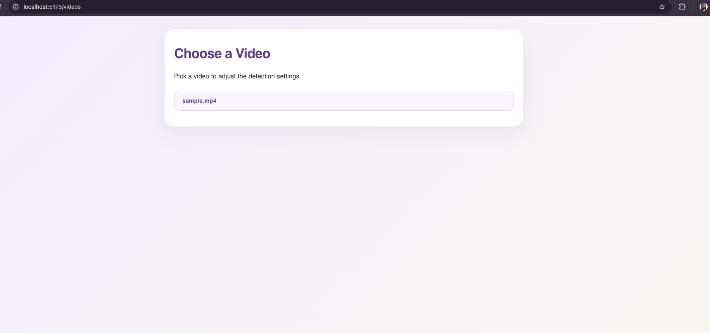
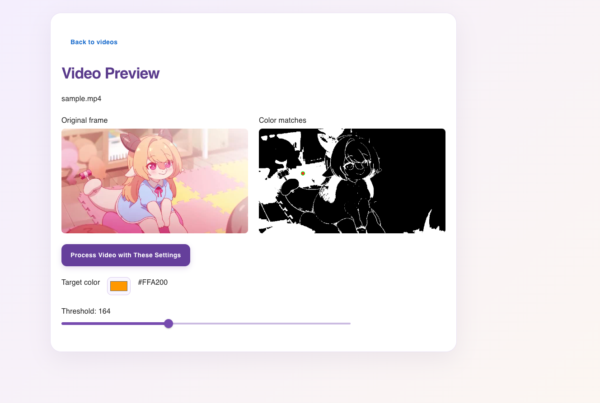

# React + Vite

This template provides a minimal setup to get React working in Vite with HMR and some ESLint rules.

Currently, two official plugins are available:

- [@vitejs/plugin-react](https://github.com/vitejs/vite-plugin-react/blob/main/packages/plugin-react) uses [Oxc](https://oxc.rs)
- [@vitejs/plugin-react-swc](https://github.com/vitejs/vite-plugin-react/blob/main/packages/plugin-react-swc) uses [SWC](https://swc.rs/)

## React Compiler

The React Compiler is not enabled on this template because of its impact on dev & build performances. To add it, see [this documentation](https://react.dev/learn/react-compiler/installation).

## Expanding the ESLint configuration

If you are developing a production application, we recommend using TypeScript with type-aware lint rules enabled. Check out the [TS template](https://github.com/vitejs/vite/tree/main/packages/create-vite/template-react-ts) for information on how to integrate TypeScript and [`typescript-eslint`](https://typescript-eslint.io) in your project.

## Centroid Finder

I made this React frontend so users can choose a video and try different detection settings before processing it. It connects to our backend and uses Material UI for the page layout and controls.

The preview shows the original image beside a black-and-white version. Changing the color or threshold updates the preview, and a dot marks the center of the largest connected group.

For my extra feature, I added the option to click the original image to pick a color. This makes it easier to select a color directly from the video.

Once the settings are ready, users can start processing. The app checks the job status and shows a CSV download link when it is done.

I also added a withLoading higher-order component to handle loading and error messages on the video chooser page.

### How to run it

First, install the frontend dependencies:

```bash
npm install
```

Set up the backend using its README, including the Java processor and video files. From the backend's server folder, run:

```bash
npm start
```

Then open another terminal in the frontend folder and run:

```bash
npm run dev
```

Open http://localhost:5173/videos and keep both servers running. The frontend's development proxy connects to the backend on port 3000.

### Testing

I wrote two Cypress tests. One checks that choosing a video opens its preview. The other checks that processing sends the settings, disables the button while waiting, and shows the CSV link when finished.

These tests use mock API responses. The processing test also returns a missing thumbnail on purpose, so seeing that image error during the test is expected.

With the frontend running, open another terminal and run:

```bash
npx cypress open
```

Choose E2E Testing, then run videos.cy.js and processing.cy.js.

I also checked the code and production build using:

```bash
npm run lint
npm run build
```

### Screenshots

The video chooser page:



The preview page with the detection settings:


